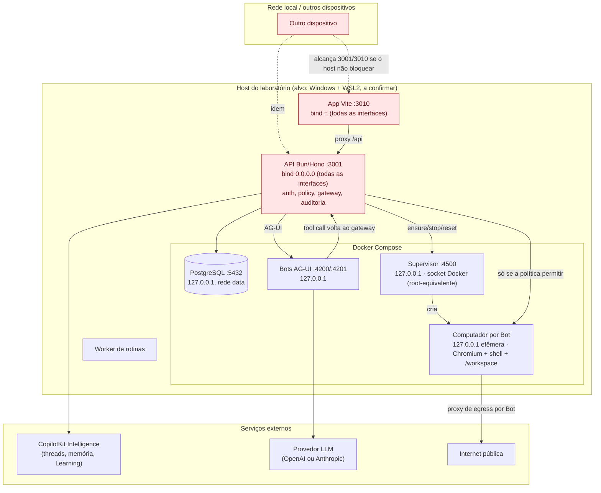

# 01 — Arquitetura do laboratório, trust boundaries e decisões

Base: código no SHA `e16d90b`, lido em 2026-10-10. Detalhe de portas e evidências em
[`00-discovery.md`](00-discovery.md).

## 1. Diagrama como o código se comporta hoje

Os nós em vermelho são o ponto que impede o laboratório de rodar como está: com
`OPENBOT_SINGLE_USER=true` (padrão do `.env.example`), qualquer requisição que chegue a 3001 ou 3010
entra como o administrador fixo `dev-local-user` (`server/src/auth/dev-actor.ts:24-28, 91-93`).

## 2. Trust boundaries

| # | Fronteira | Controle existente no código | Lacuna verificada |
|---|---|---|---|
| TB1 | Rede → API/App | Nenhum bind restrito; guarda de single-user lê só URLs configuradas (`config.ts:468-500`) | API e App expostos em todas as interfaces (R-01) |
| TB2 | Usuário → papel admin | Com single-user, todo request é admin | Admin altera a política (`PUT /policy`, `computer/routes.ts:714`) e grants |
| TB3 | Bot → ação no computador | Gateway: resolve, decide (CEL), audita, executa (`computer/gateway.ts`) | Default `allow: ["true"]`; leitura (screenshot/snapshot) e `humanInput` fora do gateway |
| TB4 | Bot → MCP / conectores | Grant em `plugin_grants` + mesma política + auditoria (`plugins/store.ts:7006`) | Nenhum grant MCP deve existir na PoC |
| TB5 | Computador → rede | Proxy de egress por Bot com política de rede; metadata sempre negado (`docs/architecture.md`, seção Computers) | Socket bruto ignora o proxy; guarda de host privado no servidor é por string, sem DNS |
| TB6 | Supervisor → Docker daemon | Bind loopback, token obrigatório | Token de dev fixo e público se não definido; socket = root no host |
| TB7 | API → Intelligence / LLM | Chave de projeto server-side | Conversas saem do host; Learning coleta se houver container atribuído |
| TB8 | Auditoria → leitor | `audit_events` no Postgres, redação por nome de chave | Comando de shell gravado inteiro, sem redação |

## 3. Arquitetura-alvo da Fase 1 (desenho, ainda não aplicado)

Diferenças em relação ao diagrama acima, todas sujeitas a aprovação:

1. **API e App presos a loopback** (ADR-004). Sem isso, a Fase 1 não inicia.
2. **Política efetiva deny-all em `enforce`** com banco novo, verificada pela linha
   `computer.policy_loaded` e por uma ação recusada (ADR-005).
3. **Learning pausado no Admin antes do primeiro chat** e `setup-learning.ts` não executado
   antes disso (ADR-006).
4. `OPENBOT_GENERATIVE_UI=false`; tokens `SUPERVISOR_TOKEN`, `COMPUTER_TOKEN`,
   `WORKER_SHARED_SECRET` gerados com `openssl rand` e gravados só no `.env`.
5. Serviços fora do escopo não sobem: `spire-*` (usa `pid: host` e socket Docker) e
   `agent-harness` (monta `./.langchain` com escrita).
6. Um único Bot, sem grant MCP, sem credenciais de terceiros.

## 4. Registro de decisões

| ADR | Tema | Status |
|---|---|---|
| [ADR-001](decisions/ADR-001-standalone.md) | Fork como aplicação autônoma, caminho B (clone) | Aceito |
| ADR-002 | Windows + WSL2 + Docker Desktop | **Pendente**: host-alvo não observado |
| ADR-003 | Somente dados sintéticos | Pendente de registro; sem objeção técnica |
| [ADR-004](decisions/ADR-004-single-user-loopback.md) | Single-user só com bind comprovadamente loopback | Proposto; exige escolha de mitigação |
| [ADR-005](decisions/ADR-005-deny-all-enforce.md) | Política deny-all em `enforce` | Proposto |
| [ADR-006](decisions/ADR-006-learning-paused.md) | Automatic Learning pausado | Proposto |
| ADR-007 | Intelligence gerenciado e LLM só com orçamento e termos validados | Pendente: depende de leitura de termos e orçamento do usuário |
| ADR-008 | MIA, Tandem, Trekup, Sanwey-OS intocados | Pendente de registro; vigente pelo plano |
